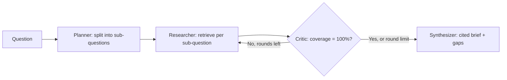

# AtlasGraph: LangGraph Multi-Agent Research System

**LangGraph multi-agent system | agentic AI research | multi-agent orchestration | RAG research agent | AI agent evaluation | Python AI project**

AtlasGraph is a multi-agent research system built in the style of LangGraph: a Planner agent splits a question into angles, a Researcher agent retrieves evidence for each angle, a Critic agent checks coverage and sends thin research back for another round, and a Synthesizer writes a cited brief — stating its gaps instead of inventing answers.

This is not a single-prompt chatbot. It is a state graph with conditional edges, a revision loop, and a guaranteed termination limit, plus an offline core that runs and tests with no API key.

## How it works



1. **Planner** — splits multi-part questions, or expands a single topic into definition, mechanism, and uses/limits angles.
2. **Researcher** — retrieves evidence for every sub-question and dedupes documents across angles.
3. **Critic** — coverage is the share of sub-questions with at least one retrieved document. Below 100% it routes back for a wider second round; at the round limit it stops rather than looping forever.
4. **Synthesizer** — writes findings with a source for each angle, lists uncovered angles under "Gaps", and reports a confidence score equal to coverage.

## Run it (no API key needed)

```bash
python3 tests/test_graph.py
python3 demo/run_demo.py
```

The demo runs the graph on sample queries from `samples/queries.json` against the local corpus in `samples/corpus.json`. Swap that corpus for your own documents, or plug a vector store into `src/retrieval.py` — the graph nodes do not change.

## Project structure

```text
src/        Graph nodes: planner, researcher, critic, synthesizer
tests/      Unit tests: planning, retrieval ranking, dedup, critic, termination, gaps
demo/       Demo runner printing full Markdown briefs
samples/    Example corpus (agentic AI, LangGraph, RAG, OpenCV) and queries
docs/       Architecture and setup notes
```

## Why this is not a simple project

- **Conditional routing, not a straight pipeline** — the critic's verdict decides whether research loops again.
- **Honest failure modes** — zero-score documents are dropped, gaps are reported, and confidence is coverage, not a made-up percentage.
- **Guaranteed termination** — the revision loop is capped at 2 rounds, so the graph can never loop forever.
- **Tested behaviour** — retrieval ranking, dedup, critic revision, termination, and gap reporting are all covered by tests.

## SEO and GitHub topics

Suggested GitHub topics: `langgraph`, `multi-agent`, `agentic-ai`, `research-agent`, `rag`, `python`, `ai-agents`, `llm`, `opencv`, `automation`

## License

MIT — see LICENSE.
